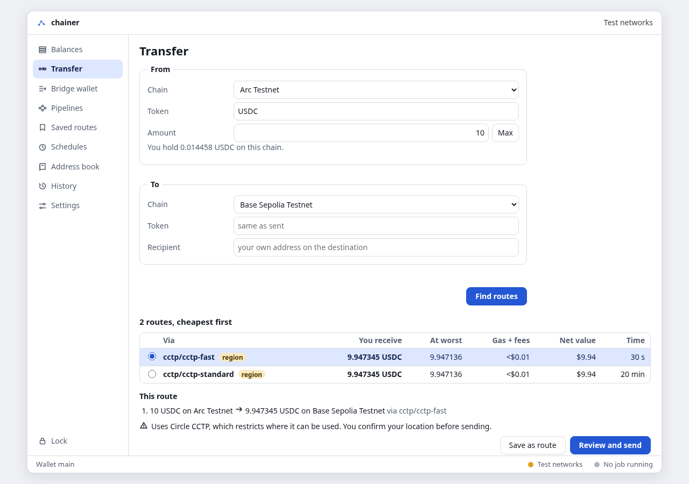
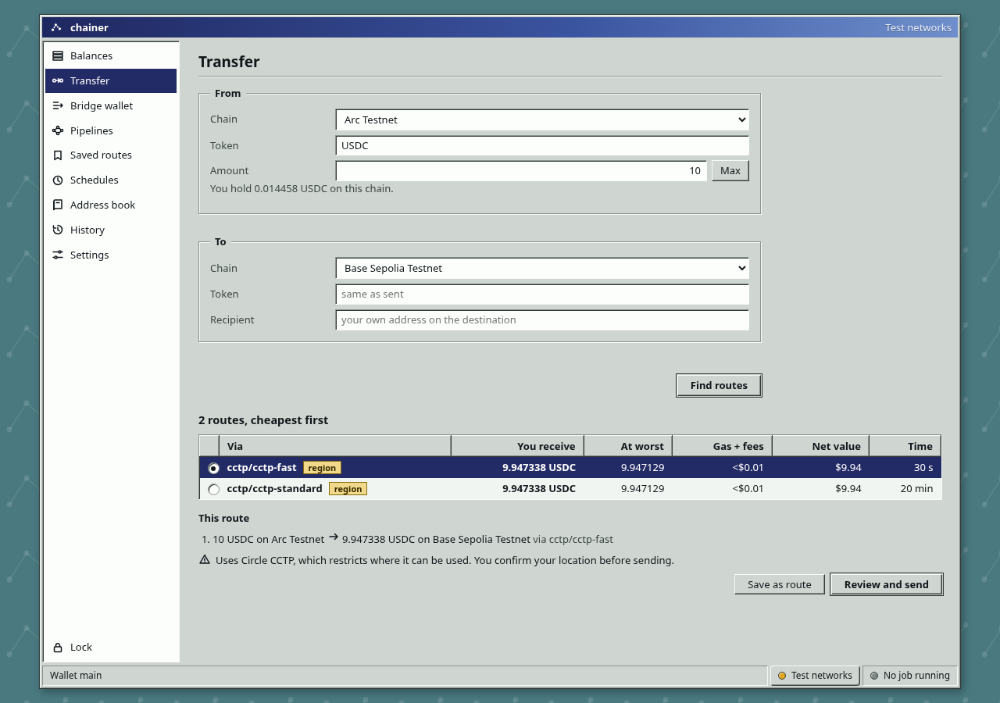
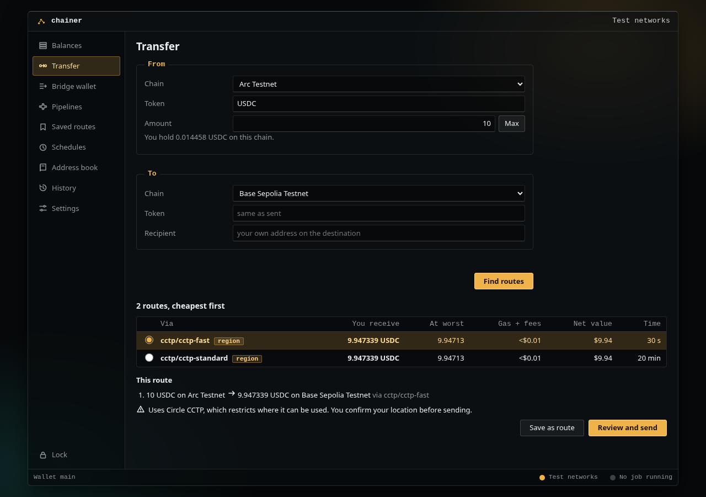
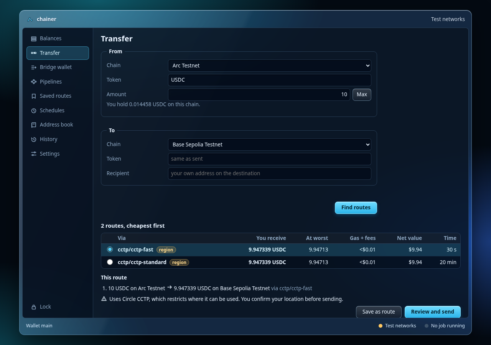
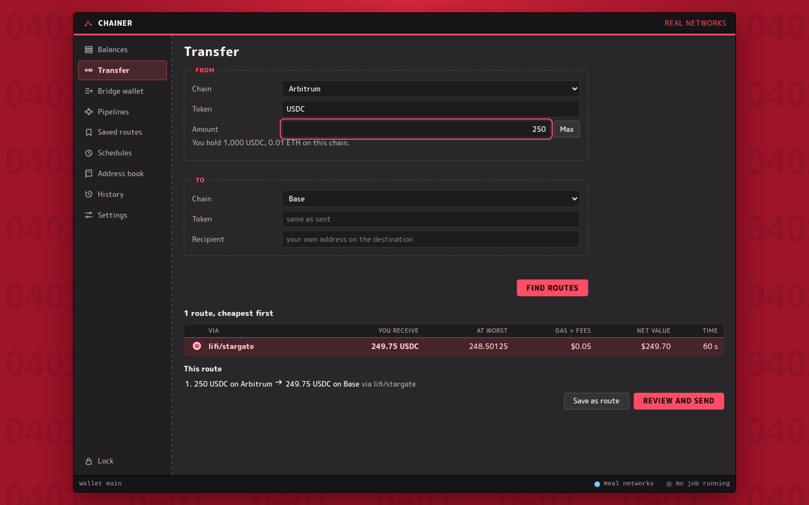

# web3_chainer

Moves tokens from one blockchain to another over the best available route, and follows the transfer until the funds arrive.

- **Finds the best route.** Compares every bridge it can reach for a transfer and ranks them cheapest or fastest. If two chains have no direct connection, it finds a route through other chains.
- **Chains transfers.** A plan can have several legs; each starts by itself once the previous one has arrived.
- **Permissionless only.** It uses only non-custodial services that need no account and no KYC. Your keys stay on your machine, encrypted.
- **Careful with funds.** Every step is written to a journal first, so a crash or a closed laptop never loses track of a transfer.

## Status

The command-line tool works today for EVM chains (Ethereum, Arbitrum, Base, Optimism, Polygon and about 55 more), Solana and Bitcoin through the [LI.FI](https://li.fi) bridge aggregator. EVM transfers have been verified with real bridge transfers on test networks; Solana and Bitcoin signing is covered by automated tests only, because LI.FI has no test network for them.

Also available: THORChain and Maya as extra route sources, covering Bitcoin, Litecoin, Dogecoin, Bitcoin Cash and Dash (and Solana through THORChain) without an aggregator. Their transaction building is covered by automated tests; their live behaviour has been checked with read-only quotes only.

Still to come, in this order: more route sources (NEAR Intents, Chainflip, direct bridges, atomic swaps), whole-wallet bridging, saved routes and scheduling, the graphical app, Lightning and Cosmos, WalletConnect. The full plan and its progress are in [docs/PLAN.md](docs/PLAN.md).

> This is young software that moves real money. Try a route with `--dry-run` or `--testnet` first, and start with small amounts. It comes with no warranty; see [Disclaimer](#disclaimer).

## Install

**Without installing anything else:** each [release](https://github.com/daMarxrider/web3_chainer/releases) has the command line as one executable for Linux (x64, arm64), macOS (Apple silicon, Intel) and Windows (x64), with Node.js inside. Unpack `chainer-<version>-<system>-<cpu>.tar.gz` (`.zip` on Windows) and run `chainer` from that folder or put it on your `PATH`. It is unsigned: on macOS run `xattr -d com.apple.quarantine chainer` once after unpacking a download from a browser, on Windows choose More info, then Run anyway. It cannot load the optional route sources below; run it from source for those. The archive holds the licence texts of the app, of Node.js and of every package built into it.

**From source:** clone the repository and run the script for your system. It installs every dependency (git, Node.js 24 or newer, the npm packages), runs the tests and adds the `chainer` command. It is safe to run again.

```sh
git clone https://github.com/daMarxrider/web3_chainer.git
cd web3_chainer
```

| System | Command |
|---|---|
| Linux (Arch, Debian, Ubuntu, Fedora) | `./scripts/install-linux.sh` |
| macOS | `./scripts/install-macos.sh` |
| Windows | `powershell -ExecutionPolicy Bypass -File scripts\install-windows.ps1` |

The Linux script is tested on clean Arch, Debian, Ubuntu and Fedora systems. The macOS and Windows scripts have not been run on those systems yet.

### Optional route sources

Some route sources need a vendor's SDK. These are not installed by default and the app works without them; it just does not offer those routes. `chainer providers` shows what is installed.

| Source | What it adds | Install |
|---|---|---|
| Atomiq | Trustless Bitcoin <-> Solana swaps (SOL and BTC only) | `npm install --no-save @atomiqlabs/sdk @atomiqlabs/chain-solana @solana/web3.js` |

Atomiq asks for a location confirmation like other geo-restricted sources (its terms bar the United States). It keeps its swap records in the data folder under `atomiq/`; do not delete that folder while a swap is unfinished.

On Android the command-line tool runs in [Termux](https://termux.dev) (`pkg install nodejs git`, then `npm ci` in the repository); there is no install script for it.

## Using the command line

### 1. Create or import a wallet

```sh
chainer wallet init        # new wallet; shows the seed phrase once, write it down
chainer wallet import      # or import a seed phrase or private key
chainer wallet list
chainer wallet refresh     # wallets made before Solana and Bitcoin support: adds their addresses
```

A wallet made from a seed phrase has an address on every supported chain family (EVM, Solana, Bitcoin, Litecoin, Dogecoin, Bitcoin Cash, Dash). A wallet imported from a single EVM private key only works on EVM chains.

The wallet is stored encrypted under a password you choose. You can add more wallets with `--name` and pick one per command with `--wallet`.

### 2. Look at what you have

```sh
chainer chains             # supported chains
chainer balances arbitrum  # your tokens on a chain
```

### 3. Compare routes

```sh
chainer quote 100 USDC arbitrum base             # same token on another chain
chainer quote 100 USDC arbitrum ETH optimism     # into a different token
chainer quote 100 USDC arbitrum base --prefer fastest
```

Nothing is sent. You get a table of routes with what you would receive, the worst case, gas and fees, and the expected time.

### 4. Send

```sh
chainer send 100 USDC arbitrum base
chainer send 100 USDC arbitrum base --to 0xRecipient...
chainer send 100 USDC arbitrum base --dry-run    # stops before signing
```

You confirm once. After that it runs by itself and shows live status until the funds have arrived.

Some bridges only allow use from certain countries. Routes that use one are marked `[geo]` in the table, and before sending you get a warning that lists the bridge, the countries or regions it excludes and the terms that say so. The run starts only if you type `yes` to say you are currently in none of them; `--yes` does not skip this question. Without that confirmation those bridges are never used. `chainer geo` lists every bridge with a restriction. Plans and resumed runs ask the same question. Paxos Labs Transit is excluded from route searches altogether.

### 5. Chain several transfers

Write a plan file:

```yaml
legs:
  - amount: 100
    from: USDC@arbitrum
    to: USDC@base
  - amount: all          # everything the previous leg delivered
    from: USDC@base
    to: ETH@optimism
```

```sh
chainer pipeline run plan.yaml --dry-run   # check it first
chainer pipeline run plan.yaml
```

### Saved routes

```sh
chainer route save weekly all USDC arbitrum base --min 95 --fallback   # keep a transfer under a name
chainer route save-sweep payday arbitrum base --target USDC            # or a whole-wallet sweep
chainer route list
chainer route run weekly --dry-run        # re-quotes along the saved path, sends nothing
chainer route run weekly --testnet        # try it on test networks first
chainer route remove weekly
```

A saved route keeps what you meant (wallet, tokens, chains, recipient, amount rule) and, for a transfer, the path that was best when you saved it, for example `lifi/stargateV2`. It does not keep prices: they are quoted again when it runs, and `all` means whatever the wallet holds then. If the saved path is no longer offered the run stops and says so, unless you saved it with `--fallback`, which uses the best route at that moment. `--min` sets the least you accept at worst case; a result below it always stops the run. Save routes without `--testnet`.

### Gas top-up

A recipient with no gas coin on the destination chain cannot move what arrives. By default, when a `send`, a saved-route run or a plan delivers a token to an address that holds none of the destination chain's own coin, the same source token is also sent into that coin, after the main transfer. The extra transfer is shown and confirmed together with the main one.

How much is up to you, with two modes:

- **multiplier** (default, 2x): that many times the estimated gas cost of what has to be done on the destination, worked out from the chain's current gas price for one onward transaction (a bridge deposit or swap).
- **fixed**: always the same value in US dollars.

```sh
chainer config set gasTopUpMode fixed          # off | multiplier | fixed
chainer config set gasTopUpMultiplier 3        # 0.5 to 20
chainer config set gasTopUpFixedUsd 5          # 0.10 to 50
chainer send 100 USDC arbitrum base --gas-topup 3x    # for one run: off, 3x or $5
```

In a plan file add `gasTopUp: 3x` (or `off`, `$5`) next to `wallet:` to set it for that plan. The extra is skipped, with the reason shown, when the recipient already has gas, when the transfer is too small to carry it, when the wallet cannot pay it on top, or (in multiplier mode) when the chain's gas price is unknown. It never exceeds $50, and a failure of the extra never affects the main transfer. In a plan file it covers the last chain only, and only when the first leg has a fixed amount. The chains a route or plan stops on are handled as described under Transit wallets (for plans, sized from the node's gas estimate, because the legs are not quoted until they run; this too needs a fixed first amount, so a plan that starts with `all` gets no stop-over gas).

### Transit wallets

A wallet made from a seed phrase has an address on every chain. A wallet made from one EVM private key has none on Solana or Bitcoin, so a route that stops there needs somewhere to wait. In that case the app makes a wallet for that chain (a transit wallet), writes its key to the encrypted keystore before anything is sent to it, and signs the next leg with it. They show up in `chainer wallet list` as `transit (<chain>)`.

- A stop-over wallet needs the chain's own coin to pay for the next leg. If a route leaves another token there (say USDC on Solana) and the wallet holds none of that chain's coin, a small extra transfer from your source wallet sends gas there first, sized as the gas top-up setting says (default: twice the quoted cost of the next leg; see Gas top-up), and the main route starts only after it has arrived. It is shown and confirmed with the transfer, and also applies to seed phrase wallets that have no gas on a stop-over chain. With the top-up switched off, routes that would leave another token on a transit wallet are not offered.
- Transit wallets are made only for the route you actually run, are reused for the same chain, and are never deleted. To move leftovers out, use them like any wallet: `chainer sweep solana ethereum --wallet transit-sol-1 --to main-address`.
- Seed phrase wallets never need them.

### Schedules and the daemon

```sh
chainer schedule add weekly --every 7d --start 2026-12-05T09:00        # repeat, from a start time
chainer schedule add payday --at 2026-12-31T09:00                      # once
chainer schedule add weekly --when-fees-below 3 --check-every 30m     # when gas and fees are low enough (add --repeat to keep going)
chainer schedule list
chainer schedule remove <id>
CHAINER_PASSWORD=... chainer daemon                                    # carries them out; keep it running (--once for a single pass, e.g. from cron)
```

A schedule runs a saved route (see above), so save the route first. Nobody is there to answer questions during an unattended run, so the location form is answered once when you create the schedule; a run that would need a restricted service you did not confirm is skipped. Unattended runs sign with the wallet's stored key, so the daemon needs the password (`CHAINER_PASSWORD`, or typed once at start). Times are your local time unless written with `Z`.

### Address book

```sh
chainer book add cold ethereum 0x...        # saved only if the address is valid on that chain
chainer book list
chainer send 100 USDC arbitrum ethereum --to cold
chainer book remove cold [ethereum]
```

A label is tied to a chain, so the same name can hold a different address on each chain; `--to cold` (and `recipient:` in plan files) uses the one saved for the destination chain, and says so if there is none. Labels cannot look like addresses or contain spaces.

### Move a whole wallet

```sh
chainer sweep arbitrum base --dry-run              # plan only: what would go, what is skipped and why
chainer sweep arbitrum base                        # run it, one transfer per token
chainer sweep arbitrum base --tokens USDC,DAI      # only some tokens
chainer sweep arbitrum base --target USDC          # receive everything as one token
```

Each token held on the source chain becomes its own transfer, biggest value first, and the chain's own coin goes last with enough held back to pay the gas of the others. Tokens with no matching token on the destination, no route, or fees higher than their value are skipped and listed with the reason. You confirm once (and the location form appears if a route needs it); a failure in one token does not stop the rest.

### 6. Check on runs, or continue one

```sh
chainer status             # all runs
chainer status 8e96ae89    # one run in detail
chainer resume 8e96ae89    # continue a run that stopped or failed
```

Finished legs are never repeated. A leg that was interrupted in the middle of sending is never re-sent automatically; `resume` tells you to check the wallet's recent transactions first.

### Try it with test funds

Step by step, with every faucet and what each one needs: [docs/TESTNET.md](docs/TESTNET.md).

`--testnet` runs a route on the test networks of Ethereum, Optimism, Arbitrum and Base (their Sepolia networks) with worthless test tokens:

```sh
chainer send 5 USDC base arbitrum --testnet
chainer status --testnet
```

### Settings

```sh
chainer config show
chainer config set prefer fastest               # default ranking: cheapest or fastest
chainer config set slippage 0.005               # 0.5 %
chainer config set maxUsdPerTransfer 500        # refuse larger transfers ("off" to disable)
chainer config set maxHops 3                    # most legs an automatic route may have
chainer config avoid add USDT                   # never route through or into this token
chainer config rpc arbitrum https://my-node...  # use your own RPC node ("default" to undo)
chainer geo                                     # bridges with geo restrictions, and where
chainer providers                               # route sources, and which optional SDKs are installed
chainer sweep <from-chain> <to-chain>           # whole-wallet transfer, see above
chainer book list                               # named recipient addresses
chainer route list                              # saved routes, see above
```

### Scripting

Every command takes `--json`. `--yes` skips the confirmation, and the `CHAINER_PASSWORD` environment variable supplies the wallet password. `CHAINER_HOME` moves the data folder.

## Using the graphical app

The graphical app has the same functions as the command line, in a window that also works on a phone-sized screen: first launch, wallet, Balances, Transfer, Bridge wallet (whole-wallet sweeps), Pipelines (hand-written multi-leg plans), Saved routes, Schedules, Address book, History and Settings. It runs as a desktop app (Linux, macOS, Windows), as an Android app and in a browser window.

Run it from the repository:

```sh
npm install
npm run dev -w @chainer/gui        # opens on http://127.0.0.1:5173
```

**Downloads.** Each release on GitHub has the desktop app (and the command line, see Install) for Linux (deb, rpm, AppImage), macOS (Apple silicon and Intel) and Windows (msi and setup.exe). They are not signed yet, so your system asks before the first start: on macOS right-click the app and choose Open, on Windows choose More info, then Run anyway in the SmartScreen window.

**Desktop app (Tauri).** On Linux, `./scripts/install-linux.sh --desktop` also installs Rust and the libraries the shell needs (Arch, Debian, Ubuntu and Fedora package names; this option has not been run on those systems yet). Then:

```sh
npm run desktop:dev -w @chainer/gui      # opens the app in its own window, with live reload
npm run desktop:build -w @chainer/gui    # builds the packaged app under apps/gui/src-tauri/target/release/bundle
```

**Android app (Tauri).** Releases will carry an APK once the app has its signing key; until then build it yourself. You need the Android SDK and NDK (`ANDROID_HOME` and `NDK_HOME` set), Java 17 or later and the Rust Android targets (`rustup target add aarch64-linux-android armv7-linux-androideabi i686-linux-android x86_64-linux-android`). Then:

```sh
npm run tauri -w @chainer/gui -- android dev          # runs on a connected phone or a running emulator
npm run tauri -w @chainer/gui -- android build --apk  # release APK, under apps/gui/src-tauri/gen/android/app/build/outputs/apk
```

The release APK is built unsigned (Android will not install it as it is). Releases are signed on the maintainer's machine so the key never goes to GitHub; see *Signed Android releases* under Versions. The build needs a good deal of memory: do not run the emulator while it builds on a machine with 16 GB or less. On a phone the wallet stays in the app's private storage, excluded from cloud backup and device transfer, and Android's back button closes dialogs.

In the desktop app the network requests go through Tauri's HTTP plugin (the window itself may not call other origins) and a content security policy limits the page to its own files. The wallet and journal stay in the app's own storage on this machine.

1. **First launch.** Choose a look, read and accept the disclaimer, then create a wallet (a seed phrase is shown once; write it down) or import one. The wallet is encrypted with your password and stored on this device only.
2. **Unlock** with the password. **Lock** is at the bottom of the screen list.
3. **Balances.** Pick a chain to see what the wallet holds and its address on that chain (with a Copy button, for funding it).
4. **Transfer.** Choose the chain and token to send and where to (the token field lists the chain's own coin, BTC, SOL and stablecoins and what you hold, and finds others as you type; tokens on Uniswap's curated token list come first, others are tagged, and tokens flagged as scams are not offered), enter an amount or `all` for the whole balance (Max does the same), press Find routes, pick a route from the ranked table (what you receive, the worst case, gas and fees, net value, time; a `region` tag marks services with location restrictions), then Review and send. The confirmation window shows the amounts, route and recipient, and asks for your location if a restricted service is used. Progress is shown step by step. **The route you choose is the route that runs.** Save as route keeps it under a name.
5. **Unfinished transfers.** If the app is closed or crashes during a transfer, it shows up at the top of the Transfer screen and in History after unlocking, with a Resume button. A step that already went out is never sent twice.
6. **Bridge wallet.** Pick two chains, press Show tokens, tick the tokens to move (there is a select-all box), optionally choose one token to receive everything as, and Plan the sweep. Each token becomes its own transfer, biggest value first, and the chain's own coin goes last with gas held back. Skipped tokens are listed with the reason. After one confirmation they run one after another; one failing does not stop the others.
7. **Pipelines.** Write a chain of legs yourself (the first has an amount, later legs send "all" of what arrived, starting where the last ended), Dry run to see what each leg would deliver, then Review and run.
8. **Saved routes and Schedules.** Saved routes are re-quoted along their saved path when they run. A schedule (once, repeating, or when gas and fees are low) runs a saved route while the app is open and the wallet unlocked; the location form is answered once when you create the schedule.
9. **Address book and History.** Saved addresses are validated against their chain and can be typed as the recipient; History lists every run, with the reason when one stopped.
10. **Test networks.** Click the network button in the status strip (bottom) to switch between real and test networks. In test mode everything runs on test networks with test funds, and the confirmation says so. See [docs/TESTNET.md](docs/TESTNET.md) for free test funds.

The desktop app keeps the wallet, settings and journal in the same data folder as the command line (`CHAINER_HOME`, otherwise `~/.config/chainer`, or `%APPDATA%\chainer` on Windows), as owner-only files, so both use the same wallet. Versions before this one kept them in the app's web view storage; the first start moves them into the folder. If the folder already holds a different file under the same name (for example a wallet made with the command line), that file is kept, the app's copy is saved under `webview-backup/` in the folder, and the app says so. The browser build (`npm run dev`) keeps everything in the browser's local storage.

### Themes

The app asks for a theme on first launch, and the choice can be changed later in the settings:

- **Modern** (the default): the same layout as the others, flat, light or dark with your system
- **Retro**: an original early-2000s desktop look, designed for this project and not a copy of any operating system's interface
- **Smoked glass**: near-black smoked glass panels with amber instrument accents and mono readouts
- **Night glass**: a translucent frame with a diagonal sheen around a dark pane, cyan accent
- **Crimson ticket**: a crimson stage with a faint "0401" print, graphite windows under a black title bar with a red rule, dashed ticket edges and rounded type (M PLUS Rounded 1c, SIL Open Font License)

The Transfer screen with ranked routes in each theme (browser build, test networks, Arc Testnet to Base Sepolia through Circle CCTP; captured 26 Nov 2026):

| Modern | Retro |
|---|---|
|  |  |
| **Smoked glass** | **Night glass** |
|  |  |
| **Crimson ticket** | |
|  | |

## Where your data lives

Settings, the encrypted wallet file and the transfer journal are in `~/.config/chainer` on Linux and macOS and `%APPDATA%\chainer` on Windows. Back up your seed phrase separately; the wallet file is useless without its password.

## Development

```sh
npm ci
npm test            # unit tests, and the CLI run end to end against a fake network (nothing leaves the machine)
npm run test:gui    # the GUI in headless Chromium against the same fake network (needs chromium)
npm run typecheck
npm run chainer -- quote 100 USDC arbitrum base
./scripts/test-install-linux.sh   # install script on clean Arch, Debian, Ubuntu, Fedora
```

**Versions.** One version (`MAJOR.MINOR.PATCH`) covers the whole app: the command line, the desktop app and every bundle. The root `package.json` holds it and `npm run version:check` (also part of `npm test`) fails when any other file disagrees. What a release bumps:

- a bug fix bumps the patch (0.4.2 to 0.4.3);
- a new feature bumps the minor (0.4.2 to 0.5.0);
- anything that breaks backwards compatibility (saved data, plan files, command options, settings) bumps the major, also while on 0.x (0.4.2 to 1.0.0).

The app stays on 0.x until milestones 1 to 8 of the [plan](docs/PLAN.md) are done; the first release after that is 1.0.0. A release takes the largest bump among the changes since the last tag.

**Releases.**

1. On a branch: `npm run version:bump -- patch` (or `minor`, `major`, or an exact `X.Y.Z`) sets the version in every file; commit it and merge the pull request.
2. On an up-to-date `main`: `npm run version:tag` checks the files and creates the tag `vX.Y.Z`; `git push origin vX.Y.Z` starts the build.

The "Release builds" workflow refuses a tag that does not match the version, builds Linux, macOS and Windows and attaches the bundles to a draft release, which is published by hand after a look. Pull requests that touch the desktop build run the same builds and keep the bundles as workflow artifacts.

**Signed Android releases.** The Android signing key stays on the maintainer's machine; GitHub never sees it. Pushing the tag (step 2) builds and signs the APK there, through a git hook, before the tag leaves: if the build or the signing fails, the push stops. After the push the APK is attached to the draft release in the background, once the workflow has made it, with a desktop notification (log in `~/.local/state/chainer/`). Once per machine, with the Android SDK set up as under *Android app*:

```sh
scripts/android-release.sh setup /path/to/release.jks <key alias>
```

This remembers the keystore and alias in the repository's git config, puts the key password in the desktop keyring (`secret-tool`, service `chainer-android`) and turns the hook on (`core.hooksPath .githooks`). Push the tag from the checked-out, clean tag commit, with no emulator running and about 7 GB of memory free (the hook checks all three). `scripts/android-release.sh build vX.Y.Z` and `upload vX.Y.Z` do the two halves by hand. Keep the key safe: Android refuses an update signed with a different one.

The code is TypeScript, run directly by Node.js without a build step. `packages/core` holds all logic; `apps/cli` is the command line on top of it.

## Not supported, and why

Some features were left out on purpose. This tool is meant for moving your own funds between chains cheaply and quickly, and it should stay clearly that. Features whose main effect is to hide where funds come from, or who is sending them, raise legal risk for the people who write and publish software like this, so they are not part of it.

- **Monero and other privacy coins.** They are not offered as a source, a destination or a stop-over, and they are filtered out of route sources that list them.
- **Built-in proxy, VPN or Tor routing.** The app has no setting for it and does not install or start anything of the kind.
- **Custodial or account-based services.** Only non-custodial services that need no account are used, so nobody else ever holds your funds.

These are deliberate decisions, not missing work, and requests to add them will be declined.

## Third-party services

chainer is independent software. It is not affiliated with, endorsed by or operated by any of the services it talks to, and it talks to them directly from your machine:

- **[LI.FI](https://li.fi)** for route searches and bridge transactions, through its public API without an account.
  - chainer provides this integration independently of LI.FI and without any association to it.
  - The LI.FI smart contracts are non-custodial: neither LI.FI nor chainer holds your funds at any time.
  - Those contracts forward to third-party contracts (bridges and exchanges), which carry out the transfers you start.
  - LI.FI does not warrant the availability, reliability or operability of those third-party contracts at any time.
  - LI.FI's [terms and conditions](https://li.fi/legal/terms-and-conditions) apply to your use of its contracts. Under them you confirm that you are not a US citizen or resident, are not under sanctions or in a comprehensively sanctioned country, and that your use is lawful. chainer does not check any of this; it is for you to know whether you may use LI.FI.
  - The public API allows 75 route searches and 50 transactions per two hours.
- **[THORChain](https://thorchain.org)** and **[Maya Protocol](https://www.mayaprotocol.com)** as direct route sources between Bitcoin, Litecoin, Dogecoin, Bitcoin Cash, Solana, Ethereum, Base, Avalanche, BNB Chain and Arbitrum (Maya: Bitcoin, Dash, Ethereum, Arbitrum). chainer reads their public nodes (THORChain through a Liquify gateway, 50,000 requests per day per IP) and sends your deposit to the vault address a node reports. Both are decentralised protocols: no company holds your funds, but swaps can still be refunded or delayed, and a halted chain stops deposits. They are independent of chainer. You can switch one off with `disabledProviders` in the settings.
- **[mempool.space](https://mempool.space)** (Bitcoin) and **[litecoinspace.org](https://litecoinspace.org)** (Litecoin) for Bitcoin-family balances, fee estimates and broadcasting transactions. Their public API needs no account and is offered as is, without guarantee; you can use your own Esplora-compatible server with `chainer config rpc`.
- **[BlockCypher](https://www.blockcypher.com)** (Dogecoin and Dash) and an open Bitcoin Cash node REST gateway run by [ActorForth](https://rest.bch.actorforth.org) for balances, coins to spend, fee estimates and broadcasting. Both are public and need no account; BlockCypher limits keyless use to about 100 requests an hour and its documentation asks for a token on POST calls such as broadcasting, so Dogecoin and Dash are **off until you allow it**: `chainer config set blockcypher on`. Or point chainer at your own endpoint with `chainer config rpc doge <url>`.
- **[Uniswap Labs' default token list](https://tokens.uniswap.org)** (GPL-3.0-or-later) in the app's token picker, to put well-known tokens first and mark look-alikes. It is downloaded at most once a day and kept on your device; LI.FI's token screening flags likely scams on top of it.
- **Public RPC nodes** for balances and for sending transactions: [PublicNode](https://www.publicnode.com) first, then the [Pocket Network Foundation](https://api.pocket.network) portal and [dRPC](https://drpc.org)'s public nodes; Solana also uses the Solana Labs endpoint. All need no account, are rate-limited and come with no guarantee. A few small chains use their own operator's endpoint. You can use your own node with `chainer config rpc`.

You are responsible for meeting the terms of these services.

## Disclaimer

This software is provided "as is", without warranty of any kind. You use it entirely at your own risk.

- **Loss of funds.** The author is not liable for any loss of money or tokens, including losses caused by bugs or errors in this software, by failures or changes in the bridges, exchanges, networks and other third-party services it talks to, or by price movements, fees and slippage.
- **How you use it.** The author is not liable for losses or other consequences of incorrect or improper use, such as wrong addresses or amounts, lost passwords or seed phrases, or use that breaks the law or a third party's terms. You are responsible for complying with the laws and tax rules that apply to you.
- **No advice, no service.** This is a tool you run yourself. The author does not hold your funds, does not execute transactions for you and gives no financial, legal or tax advice.

Blockchain transactions cannot be reversed. Check routes with `--dry-run` or `--testnet` first, and never send more than you can afford to lose. The full terms are in sections 15 to 17 of the [license](LICENSE).

## License

[GNU General Public License v3.0](LICENSE)
